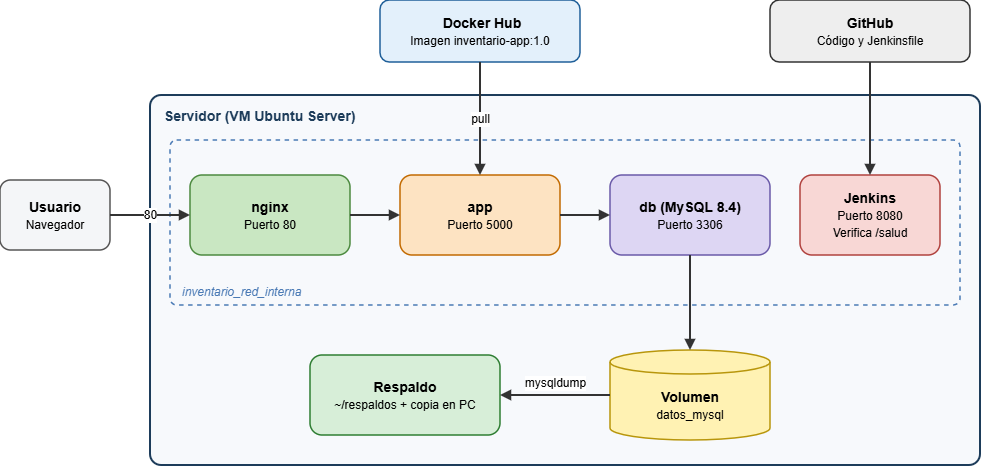

# Sistema de Inventario Tecnológico de Kicks Lab

Sistema web para llevar el inventario de los equipos tecnológicos de **Kicks Lab**, una tienda ficticia de tenis: computadoras de caja, laptops, tabletas, impresoras, lectores de código de barras, terminales de pago, cámaras y equipo de red. Se ejecuta con Docker Compose en tres contenedores (nginx, app y db), se valida con Jenkins y se respalda fuera del servidor.

Proyecto final de **Servidores II**, Universidad de Sonora, Ingeniería en Sistemas de Información. **Equipo 4**, noviembre de 2026.

> **Nota sobre los nombres de las cuentas:** la cuenta de GitHub (`Equipo3Srvs2`) y la de Docker Hub (`unisonserv2eq3`) se crearon por error con el número 3; corresponden al **Equipo 4**. El nombre de usuario de Docker Hub no puede modificarse, y Jenkins y `compose.yaml` dependen de esos nombres, por lo que se conservaron.

## Contenido

- [Arquitectura](#arquitectura)
- [Estructura del repositorio](#estructura-del-repositorio)
- [Requisitos](#requisitos)
- [Instalación desde cero](#instalación-desde-cero)
- [Configuración (.env)](#configuración-env)
- [Uso del sistema](#uso-del-sistema)
- [Operación por área](#operación-por-área)
- [Versiones](#versiones)
- [Solución de problemas](#solución-de-problemas)
- [Equipo](#equipo)

## Arquitectura



| Servicio | Imagen | Puerto | Función |
|---|---|---|---|
| `nginx` | `nginx:1.28-alpine` | 80 (publicado) | Proxy inverso; única entrada al sistema |
| `app` | `unisonserv2eq3/inventario-app:1.0` | 5000 (interno) | Aplicación Flask con Gunicorn (Python 3.12); incluye la ruta `/salud` |
| `db` | `mysql:8.4` | 3306 (interno) | Base de datos; tiene healthcheck y la app espera a que esté *healthy* |
| `jenkins` | `jenkins/jenkins:lts` | 8080 (publicado) | Validación automática del proyecto; se ejecuta aparte de Compose |

- **Red:** `inventario_red_interna` (bridge). Los servicios se encuentran por nombre: nginx → app → db.
- **Volúmenes:** `datos_mysql` (datos de MySQL en `/var/lib/mysql`) y `jenkins_home` (configuración e historial de Jenkins).
- **Componentes de operación:** control de versiones en GitHub, publicación de la imagen en Docker Hub, validación con Jenkins y respaldo y recuperación.

## Estructura del repositorio

```text
inventario/
├── app/                  # Código de la aplicación Flask, Dockerfile y plantillas (app/templates)
├── docs/
│   └── arquitectura.png  # Diagrama de la arquitectura (fuente editable en draw.io)
├── db/
│   └── init.sql          # Tabla equipos, tipos y estados (ENUM) y 12 registros de ejemplo de Kicks Lab
├── nginx/
│   └── default.conf      # Configuración del proxy inverso hacia app
├── compose.yaml          # Servicios nginx, app y db, red, volumen y healthcheck
├── Jenkinsfile           # Pipeline de validación (6 etapas)
├── .env.ejemplo          # Variables de entorno con valores de muestra
└── .gitignore            # Excluye .env
```

> El archivo `.env` con las contraseñas reales **nunca** se sube al repositorio.

## Requisitos

- Máquina virtual con Ubuntu Server, **4 GB de RAM** como mínimo (Jenkins corre junto con los tres servicios) y **20 GB** de disco libre.
- Docker Engine con el complemento Docker Compose v2.
- Git.
- Acceso a Internet para descargar las imágenes la primera vez.

## Instalación desde cero

Todos los comandos se ejecutan en el servidor.

1. Clona el repositorio y entra a la carpeta:

   ```bash
   git clone https://github.com/Equipo3Srvs2/inventario.git
   cd inventario
   ```

2. Crea el archivo de entorno y cambia las contraseñas:

   ```bash
   cp .env.ejemplo .env
   nano .env
   ```

3. Descarga las imágenes y levanta el sistema:

   ```bash
   docker compose pull
   docker compose up -d
   docker compose ps
   ```

   Los tres servicios deben aparecer como `Up`, y `db` como `(healthy)`. La primera vez, MySQL ejecuta `db/init.sql` y carga los 12 equipos de ejemplo.

4. Verifica que el sistema responde:

   ```bash
   curl http://localhost/salud
   ```

   La respuesta debe incluir `"estado": "ok"`. Después abre `http://IP-del-servidor` desde un navegador en la misma red.

## Configuración (.env)

| Variable | Valor | Descripción |
|---|---|---|
| `MYSQL_ROOT_PASSWORD` | *(secreto)* | Contraseña de root de MySQL; se usa para respaldar y restaurar |
| `MYSQL_DATABASE` | `inventario` | Nombre de la base de datos. No cambiar |
| `MYSQL_USER` | `app_inventario` | Usuario con el que se conecta la aplicación. No cambiar |
| `MYSQL_PASSWORD` | *(secreto)* | Contraseña del usuario de la aplicación |
| `ORGANIZACION` | `Kicks Lab` | Nombre que aparece en el encabezado del sistema |

> En la propuesta se mencionó `APP_NAME`, pero la aplicación lee **`ORGANIZACION`**.

## Uso del sistema

La pantalla principal muestra la tabla de equipos con su nombre, tipo, marca, número de serie, ubicación y estado. Desde ahí se registran equipos nuevos (**+ Registrar equipo**) y se editan o eliminan los existentes. Los tipos de equipo y los estados son listas fijas definidas en `db/init.sql`:

- **Tipos:** Computadora punto de venta, Laptop, Tableta, Impresora de tickets, Impresora de etiquetas, Lector de código de barras, Terminal de pago, Cámara de seguridad, Equipo de red.
- **Estados:** En uso, En almacén, En reparación, Fuera de servicio, Dado de baja.

El detalle para el encargado de sistemas y el gerente de tienda está en el **Manual de usuario** del proyecto.

## Operación por área

### Infraestructura

```bash
cd ~/inventario
docker compose ps              # estado de los servicios
docker compose logs -f app     # registro de la aplicación (Ctrl+C para salir)
docker compose stop            # detener sin borrar nada
docker compose start           # volver a iniciar
```

> **Antes de `docker compose down`, detén Jenkins** (`docker stop jenkins`): mientras esté conectado a `inventario_red_interna`, Compose no puede eliminar la red.

**Si la carpeta del proyecto se daña** (los datos se conservan porque el volumen no se borra):

```bash
cd ~/inventario && docker compose down
cp .env ~/env_respaldo && cd ~
mv inventario inventario_danado
git clone https://github.com/Equipo3Srvs2/inventario.git && cd inventario
cp ~/env_respaldo .env
docker compose up -d
```

### Datos: respaldo y recuperación

**Generar un respaldo** en `~/respaldos`, fuera del volumen de datos:

```bash
mkdir -p ~/respaldos
cd ~/inventario
docker compose exec -T db sh -c 'mysqldump -u root -p"$MYSQL_ROOT_PASSWORD" --databases inventario' > ~/respaldos/inventario_$(date +%F_%H%M).sql
ls -lh ~/respaldos
```

**Copiar los respaldos fuera del servidor**, desde PowerShell en la PC (sin conectarse por SSH):

```powershell
mkdir $HOME\Documents\respaldos_inventario
cd $HOME\Documents\respaldos_inventario
scp "usuario@IP-del-servidor:~/respaldos/*.sql" .
dir *.sql
```

**Restaurar un respaldo** (sustituye `FECHA` por la del archivo):

```bash
cd ~/inventario
docker compose exec -T db sh -c 'mysql -u root -p"$MYSQL_ROOT_PASSWORD"' < ~/respaldos/inventario_FECHA.sql
```

**Si se perdió el volumen completo:** levanta el sistema con `docker compose up -d`, espera a que `db` esté `(healthy)` (en la prueba tardó unos 52 s) y restaura el respaldo con el comando anterior. Sin restaurar, solo aparecen los 12 registros de `init.sql`.

Tiempos medidos en la prueba de recuperación (19 de noviembre de 2026):

| Falla | Tiempo de recuperación |
|---|---|
| Pérdida de registros (`DELETE FROM equipos;`) | 1 min 51 s |
| Pérdida del volumen completo (`docker compose down -v`) | 3 min 38 s |

> Respalda **antes de cada cambio importante**. Con un respaldo diario se podrían perder hasta 24 horas de cambios.

### Automatización: imagen y Jenkins

**Publicar una nueva versión de la imagen** (ejemplo con la versión 1.1):

```bash
docker login -u unisonserv2eq3          # como contraseña, usa el token de acceso
docker build -t unisonserv2eq3/inventario-app:1.1 ./app
docker push unisonserv2eq3/inventario-app:1.1
```

Después cambia la línea `image:` de `compose.yaml` a la nueva etiqueta, ejecuta `docker compose pull app` y `docker compose up -d`, y registra el cambio en Git. Usa siempre etiquetas de versión, nunca `latest`.

**Levantar Jenkins:**

```bash
docker run -d --name jenkins -p 8080:8080 -v jenkins_home:/var/jenkins_home --network inventario_red_interna jenkins/jenkins:lts
```

Entra a `http://IP-del-servidor:8080`. La tarea `validar-inventario` es de tipo *Pipeline script from SCM*, con este repositorio y la rama `*/main`. Para volver a usar Jenkins después de detenerlo: `docker start jenkins`.

> Si se ejecutó `docker compose down`, la red se vuelve a crear y Jenkins ya no puede conectarse a ella. Recréalo con `docker rm jenkins` y el mismo `docker run`. La configuración y el historial se conservan en `jenkins_home`.

Etapas del pipeline (`Jenkinsfile`):

| Etapa | Verifica |
|---|---|
| Checkout SCM | Descarga el repositorio desde GitHub |
| Archivos del proyecto | Que existan `compose.yaml`, `db/init.sql`, `nginx/default.conf` y `.env.ejemplo` |
| Credenciales protegidas | Que `.env` esté en `.gitignore` y no esté en el repositorio |
| Estructura de Compose | Servicios nginx, app y db, healthcheck e imagen `inventario-app:1.0` |
| Historial en Git | Muestra los últimos 5 commits |
| Sistema disponible | `curl -fsS http://nginx/salud` |

Si **Sistema disponible** falla con `curl: (22) The requested URL returned error: 502`, nginx está en ejecución pero la aplicación no responde: revisa `docker compose ps` y ejecuta `docker compose start app`.

### Coordinación

La documentación del proyecto (propuesta, documento de avance, documento de cierre, manual de usuario y presentación) la integra la coordinadora del equipo. Cualquier cambio en la operación del sistema debe reflejarse también en este README.

## Versiones

| Versión | Commit | Descripción |
|---|---|---|
| `v1.0` | `79bdc8d` | Versión final verificada por Jenkins después de la prueba de recuperación |

Imagen publicada: `unisonserv2eq3/inventario-app:1.0`.

## Solución de problemas

| Síntoma | Causa probable | Solución |
|---|---|---|
| La página no carga | El servidor o nginx no están en ejecución | `docker compose ps` y `docker compose up -d` |
| Página de error en lugar de la tabla | La app no se comunica con la base de datos | Espera a que `db` esté `(healthy)` y recarga; revisa `docker compose logs db` |
| La tabla aparece vacía o faltan equipos | Se borraron registros o se perdió el volumen | Restaura el último respaldo (sección de datos) |
| `docker compose down` no elimina la red | Jenkins sigue conectado a `inventario_red_interna` | `docker stop jenkins` y repite |
| Jenkins: Sistema disponible en rojo (502) | El servicio app está detenido | `docker compose start app` y vuelve a ejecutar el pipeline |
| `git push` rechaza la contraseña | GitHub no acepta la contraseña de la cuenta desde la terminal | Usa el token de acceso personal |

## Equipo

| Integrante | Área |
|---|---|
| David Antonio López Corella | Infraestructura |
| Gloria de Jesus Sanchez Lopez | Datos |
| Daniela Sandoval López | Automatización |
| Mia Rene Valenzuela Yescas | Coordinación |

Titular de la materia: Luz María Márquez Agundez.
